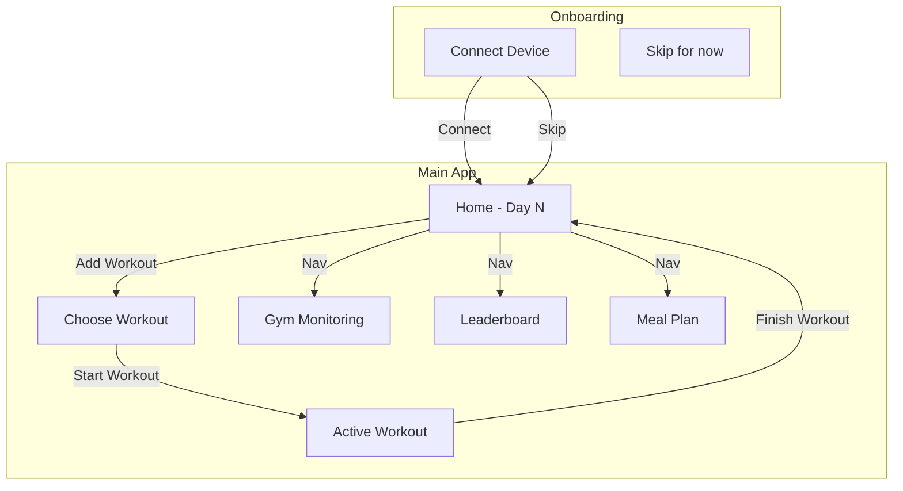

# Gympath UI Flow Diagram

## Screen Flow Overview

## Screen Descriptions

### 1. Connect Device
- **Entry**: First launch or when device not paired
- **Elements**: Smart Tracker illustration, BLE device card (Smart Tracker VN-E900), Connect button, Skip for now
- **Exit**: Connect → Home | Skip → Home

### 2. Home (Day N)
- **Entry**: From Connect, or bottom nav
- **Elements**: Day count, streak, daily activity icons, workout progress (person + cable machine), Add Workout, monthly stats, bottom nav (Home, Workouts, Nutrition, Coach)
- **Exit**: Add Workout → Choose Workout | Nav → other tabs

### 3. Choose Workout
- **Entry**: Add Workout from Home
- **Elements**: Search bar, workout list (Full Body, Barbell Bench Press, Squats, Deadlift, Pull-Up, Running), Start Workout button
- **Exit**: Start Workout → Active Workout | Back → Home

### 4. Active Workout (e.g., Barbell Bench Press)
- **Entry**: Start Workout from Choose Workout
- **Elements**: Timer, set/rep/weight rows (50 kg x 8 x 6), Total Volume, Sets, Mean Velocity, bar chart, Finish Workout, optional music player
- **Exit**: Finish Workout → Home | Back → (discard/cancel)

### 5. Gym Monitoring
- **Entry**: Bottom nav
- **Elements**: User profile, performance graph (line chart), Weekly Challenge, Alerts list (Bench Press, Running, Squats), "Underperformed Bench Press!" insight
- **Exit**: Nav → other tabs

### 6. Leaderboard
- **Entry**: Bottom nav
- **Elements**: Welcome back, activity feed, leaderboard (Sasha, You, Sarah), summary stats (5/7, 85,260, 7,450)
- **Exit**: Nav → other tabs

### 7. Meal Plan
- **Entry**: Bottom nav (Nutrition)
- **Elements**: Personalized meal plan, Gain Muscle/Moderate dropdowns, breakfast card (Scrambled Eggs, etc.), grocery list
- **Exit**: Nav → other tabs

## Bottom Navigation

| Tab      | Screen       |
|----------|--------------|
| Home     | Home         |
| Workouts | Choose Workout / Workout history |
| Nutrition| Meal Plan    |
| Coach    | Gym Monitoring / Leaderboard |
